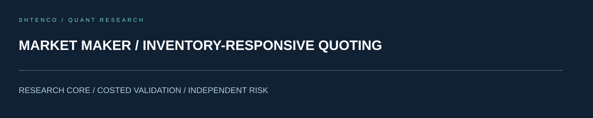
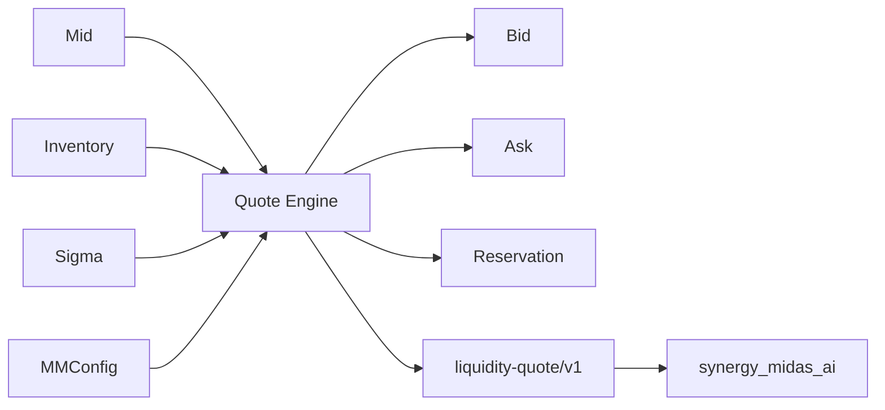

<!-- SCIENTIFIC-V4-2026:START -->


[Научное досье V4](docs/SCIENTIFIC_DOSSIER_V4_2026.md) — оригинальная модель, экспериментальная проверка, применение. Прежний README сохранён полностью.
<!-- SCIENTIFIC-V4-2026:END -->

#  SYNERGY Market Maker — verified technical dossier

> **Статус:**  CANDIDATE — quote engine, federation contract, enterprise API and tests exist in `main`.
> **Проверено по фактическому source/tests:** 29.09.2026.

## 1.  Задача

`synergy_market_maker` строит bounded liquidity quote вокруг mid price с учётом inventory, volatility и configurable spread/risk parameters.

Ключевая граница:

```text
computed quote != exchange order
quote availability != fill
model spread != realized spread P&L
```

## 2.  Фактический состав

В repository присутствуют:

- `src/synergy_market_maker/core.py`;
- `api.py`;
- `synergy_contracts.py`;
- enterprise auth/audit package;
- tests core/product/service/adapters/deployment/release/contracts;
- Dockerfile, Makefile, pyproject;
- deploy/loadtests/demo/docs/examples.

## 3.  Core model

`MMConfig`:

```text
gamma
kappa
horizon_seconds
max_inventory
min_half_spread_bps
```

`Quote`:

```text
bid
ask
reservation
half_spread
status
```

## 4.  Quote math

Input validation:

- `mid > 0`;
- `sigma >= 0`.

Если:

[
|inventory| ge maxInventory
]

engine возвращает:

```text
status = INVENTORY_LIMIT
bid = ask = 0
```

Time horizon переводится в долю года:

[
	au=
rac{horizonSeconds}{365cdot24cdot3600}
]

Reservation price:

[
r =
mid -
inventorycdotgammacdotsigma^2cdot	aucdot mid
]

Half spread — максимум между minimum bps floor и risk-model term.

Это конкретная implemented heuristic; README не называет её production-calibrated market-making model.

## 5.  Hedge helper

`hedge_notional(inventory,target,hedge_ratio)`:

[
H=-(inventory-target)cdot hedgeRatio
]

Это desired notional, а не выполненный hedge.

## 6.  Архитектура



## 7.  Federation contract

```text
CONTRACT_ID = synergy.trading.liquidity-quote/v1
AUTHORITY   = market_making
```

Payload builder требует:

- observation id;
- symbol;
- mid;
- inventory;
- sigma.

Output содержит quote fields и:

```text
authorization = false
```

То есть quote evidence сам по себе не разрешает выставить orders.

## 8.  Inputs /  Outputs

Inputs:

- market observation id;
- symbol;
- mid;
- inventory;
- volatility sigma;
- config.

Outputs:

- bid;
- ask;
- reservation price;
- half spread;
- status;
- explicit no-authorization flag.

Enterprise API дополнительно возвращает hedge notional/request id.

## 9.  Invariants

```text
invalid mid/sigma -> reject
inventory limit -> no quote
quote != fill
hedge target != hedge fill
liquidity quote != trade authorization
source observation requires provenance downstream
```

## 10.  Реальные tests

`test_enterprise_product.py` вызывает:

```text
POST /enterprise/v1/market-maker/quote
```

с mid=60000, inventory=2, sigma=0.03.

Проверяется:

- authorized `trader` получает 200;
- есть `bid`, `ask`, `hedge_notional`, `request_id`;
- request id связан с enterprise audit;
- `viewer` получает 403;
- существуют enterprise health/quote routes.

Также repository содержит tests для core, enterprise adapters/foundation/service/deployment, release metadata и SYNERGY contracts.

## 11.  Modeling gaps

Текущий core напрямую не моделирует:

- order-book depth;
- queue position;
- adverse selection;
- fill probability;
- exchange latency;
- cancel/replace;
- maker/taker fee schedule;
- multi-venue inventory;
- hedge execution costs.

Поэтому computed spread нельзя считать realized market-making edge.

## 12.  Следующие evidence tests

- monotonic inventory skew;
- volatility widening;
- inventory-limit boundary;
- min-spread floor;
- sigma=0 behavior;
- extreme gamma/kappa;
- fill simulator;
- adverse selection stress;
- fee/slippage P&L;
- multi-venue hedge latency;
- OOS inventory/P&L replay.

## 13.  Enterprise boundary

Enterprise tests демонстрируют role authorization и audit correlation. Production-ready claim потребует дополнительно:

- real secret management;
- token issuer/audience;
- persistent audit;
- tenant isolation;
- rate limits;
- execution policy separation.

## 14.  Воспроизводимость

```bash
git clone https://github.com/Shtenco/synergy_market_maker.git
cd synergy_market_maker
python -m pip install -e .
pytest -q
```

Observed CI/E2E должен фиксироваться отдельно.

## 15.  Карта repository

| Path | Role |
|---|---|
| `src/.../core.py` | quote and hedge math |
| `src/.../synergy_contracts.py` | liquidity-quote/v1 |
| `src/.../api.py` | API |
| `src/.../enterprise/` | auth/audit |
| `tests/` | core/product/service/deploy tests |
| `Dockerfile` | container |
| `deploy/` | deployment assets |
| `loadtests/` | load tests |

## 16.  Место в SYNERGY

```text
synergy_market_maker
→ synergy.trading.liquidity-quote/v1
→ synergy_midas_ai
→ separate execution/risk authority
```

## 17.  Evidence maturity

| Layer | Status |
|---|---|
| quote formula |  |
| inventory limit |  |
| federation payload |  |
| enterprise tests |  source |
| fill model |  |
| realized P&L validation |  |
| historical OOS |  |
| observed cross-repo E2E |  |

## 18.  Roadmap

1. quote timestamp/provenance;
2. order-book depth;
3. fill probability;
4. fee model;
5. adverse selection;
6. inventory risk OOS;
7. hedge execution evidence;
8. M4/M5 observed federation run.

## 19.  Что проект НЕ утверждает

- guaranteed spread capture;
- production liquidity;
- broker/exchange execution;
- positive market-making P&L;
- that quote output authorizes trading.

## 20.  Quote-behavior properties to prove

A robust quote engine should satisfy properties, not only example tests.

### Inventory monotonicity

Holding other inputs fixed, increasing positive inventory should move reservation price in the direction that discourages further accumulation. The sign and magnitude should be checked over a grid of inventory values.

### Volatility widening

For the current formula, increasing (sigma) should not make the modeled risk component of spread narrower. Property tests should sweep realistic sigma values and record bid/ask.

### Minimum spread floor

For calm markets:

[
halfSpread ge mid 	imes rac{minHalfSpreadBps}{10000}
]

must always hold.

### Quote sanity

When status=`QUOTE`:

```text
bid <= reservation <= ask
half_spread >= 0
ask - bid = 2 * half_spread
```

within floating-point tolerance.

## 21.  Required quote evidence artifact

For every production-intent quote preserve:

```text
observation_id
symbol
market timestamp
mid source
inventory snapshot id
sigma method + lookback
MMConfig version
bid / ask / reservation
model half-spread
venue fee assumptions
software commit
expiry / max age
authorization=false
```

This makes it possible to determine whether an apparently attractive quote was built from stale market state.

## 22.  From quote model to P&L evidence

A real market-making experiment must reconcile:

[
PnL =
SpreadCapture
-
AdverseSelection
-
Fees
-
HedgeCost
-
InventoryMark
]

and separately report realized vs unrealized components.

The existing core computes quotes; it does **not** compute that reconciliation. Therefore future README claims about profitability must link to a separate trade/fill ledger rather than infer P&L from half-spread.

## 23.  Promotion gate

To move from CANDIDATE quote engine to E2E_TESTED market-making component:

- observed market timestamp provenance;
- quote expiry;
- fill simulator;
- exchange/broker fee parity;
- partial fills;
- hedge execution;
- inventory limits under concurrency;
- realized P&L ledger;
- M5 federation evidence.

No performance adjective should replace these artifacts.

---

[ SYNERGY SYSTEM](https://github.com/Shtenco/synergy_system) · [ Atlas](https://github.com/Shtenco/synergy_system/blob/main/docs/SYNERGY_REPOSITORY_ATLAS.md)
