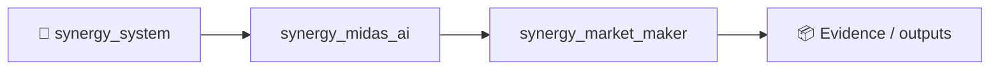
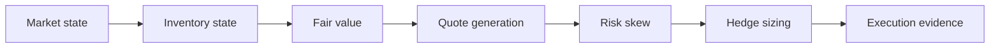

# SYNERGY Market Maker

> **Inventory-aware quoting and hedge sizing with explicit risk-control boundaries**

Version: `2.0.0`

**Enterprise v2.0.0** · FastAPI/OpenAPI · Docker/Compose · RBAC/JWT · PostgreSQL/ClickHouse audit

**Designed for:** Market makers, exchanges, OTC desks and liquidity providers  
**Primary endpoint:** `POST /enterprise/v1/market-maker/quote`

> [!IMPORTANT]
> Quoting/risk infrastructure only. No guarantee of spread capture, fills or profitability; live execution remains separately controlled.

## Verification
**21 tests passed** · health smoke **80/80 200** · local p95 **55.6 ms** (~637 req/s). Health smoke only.

## Quick start
```bash
pip install -e '.[dev,enterprise]'
pytest -q
python -m synergy_market_maker.api
```

## CTO package
[Due diligence](docs/CTO_DUE_DILIGENCE.md) · [Architecture](docs/ARCHITECTURE_DIAGRAMS.md) · [API](docs/API_EXAMPLES.md) · [Security](SECURITY.md) · [Benchmarks](docs/BENCHMARKS_AND_ACCEPTANCE.md) · [SLA/SLO](docs/SLA_SLO.md) · [Deployment](docs/DEPLOYMENT_CHECKLIST.md) · [Pilot](docs/CUSTOMER_PILOT.md)


<!-- SYNERGY-FEDERATION-PASSPORT:START -->
---

## 🧭 SYNERGY federation passport

**Домен:** 💹 Market making R&D  
**Архитектурный родитель:** [`synergy_midas_ai`](https://github.com/Shtenco/synergy_midas_ai)  
**Архитектурный корень:** [`synergy_system`](https://github.com/Shtenco/synergy_system)



Архитектурная стрелка — это карта федерации, а не автоматически подтверждённая runtime dependency.

### Единый стандарт

Каждый проект должен документировать реальную проблему, реализацию, тесты, evidence, ограничения, file map, воспроизводимость, roadmap и границы утверждений. Это тот же принцип, который используется в `dlp_solver`.

### Навигация

- [📚 Атлас всех 75 репозиториев](https://github.com/Shtenco/synergy_system/blob/main/docs/SYNERGY_REPOSITORY_ATLAS.md)
- [🧾 Машиночитаемый registry](https://github.com/Shtenco/synergy_system/blob/main/registry/SYNERGY_REPOSITORIES.json)
- [🧭 SYNERGY SYSTEM](https://github.com/Shtenco/synergy_system)

### Evidence rule

`GREEN` означает только воспроизводимо подтверждённый тезис. Гипотеза, benchmark без корректного протокола, архитектурная диаграмма или красивый экономический цикл сами по себе GREEN не дают.

<!-- SYNERGY-FEDERATION-PASSPORT:END -->
---

# 💹 Глубокая техническая спецификация Market Maker

## 🎯 Проблема

Номинальный spread не является прибылью: inventory drift, adverse selection, queue position, hedge cost и venue risk могут полностью уничтожить edge.

## 🏗️ Pipeline



## 📥 Входы

- best bid/ask + depth;
- inventory;
- volatility;
- fair value;
- fees/rebates;
- hedge venue state;

## 📤 Выходы

- bid/ask quote plan;
- inventory skew;
- hedge intent;
- quote cancel/replace reason;
- audit artifact;

## 🛡️ Непереговорные инварианты

```text
inventory limits override spread opportunity
stale market data cancels quotes
quote PnL excludes unfilled theoretical spread
hedge cost included
live dispatch gated separately
```

## 🧪 Как ловить ложный GREEN

- health/API throughput не использовать как доказательство market edge;
- обязательны timestamp/state-version checks;
- adversarial/negative fixtures должны проверять отказ;
- сохранять полный request → decision → execution/evidence trace;
- live claims отделять от local smoke и simulation;
- cost/latency/failure assumptions должны быть явными.

## 🔗 Контракт с соседями

- [`synergy_market_graph`](https://github.com/Shtenco/synergy_market_graph)
- [`synergy_riskguard`](https://github.com/Shtenco/synergy_riskguard)
- [`synergy_trademux`](https://github.com/Shtenco/synergy_trademux)
- [`synergy_financial_os`](https://github.com/Shtenco/synergy_financial_os)

## 🚀 Следующий доказательный рубеж

1. frozen acceptance fixtures;
2. negative/adversarial suite;
3. typed cross-repo schema;
4. end-to-end trace ID;
5. rollback/recovery evidence;
6. documented failure-mode table;
7. reproducible evidence bundle.
